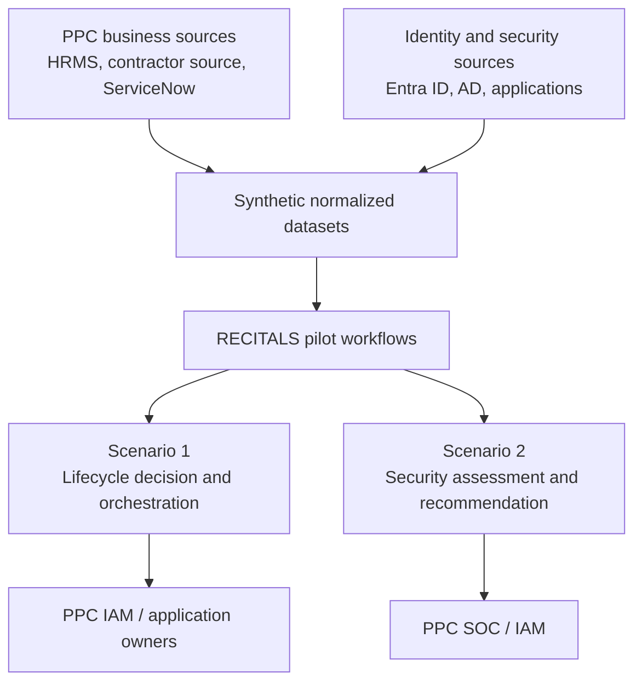
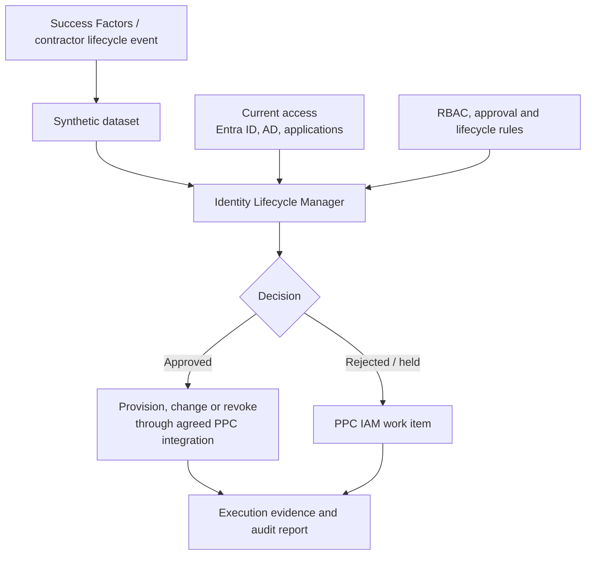
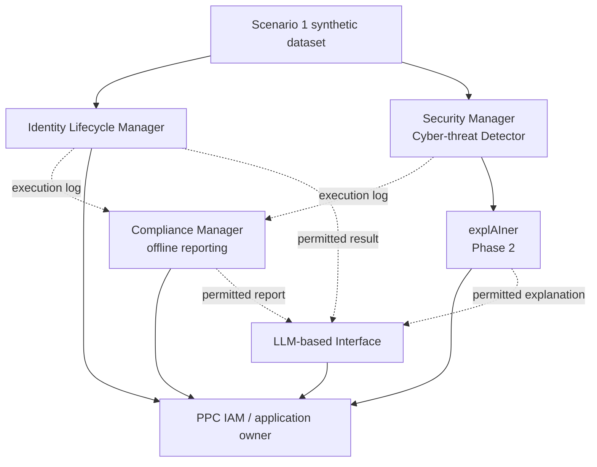
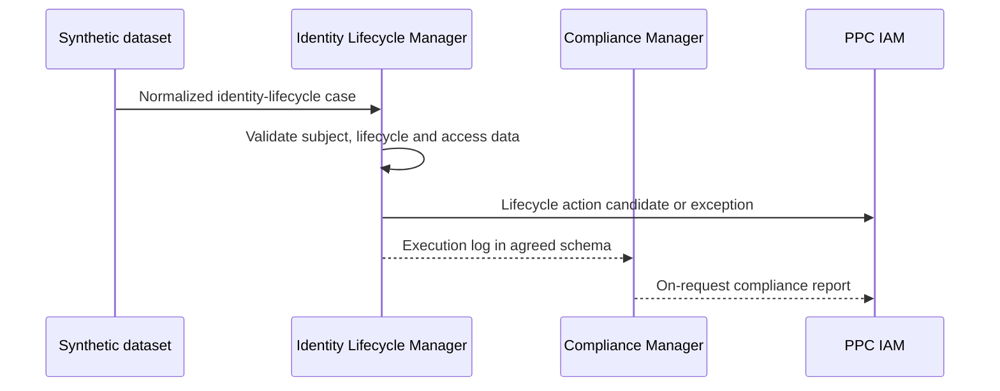
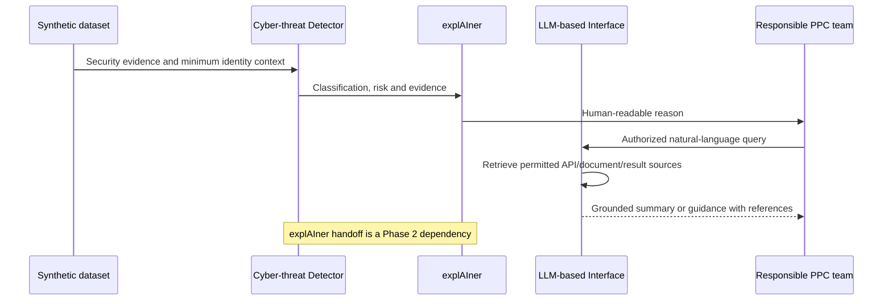
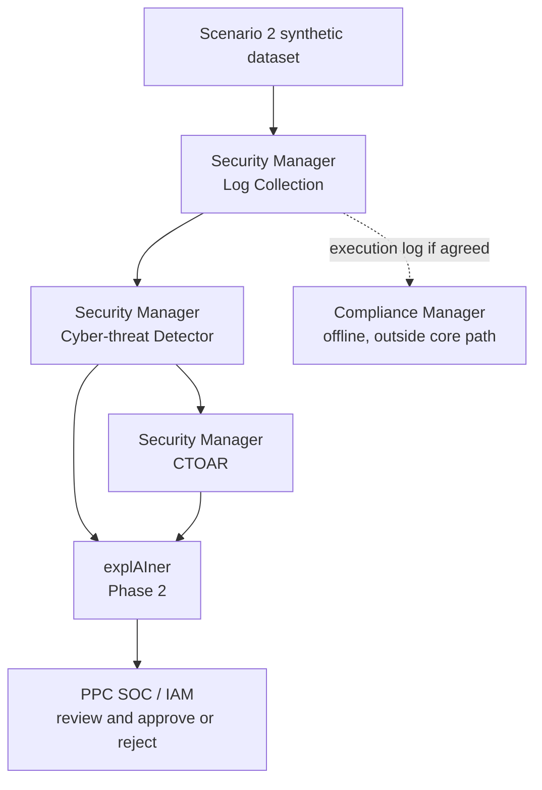
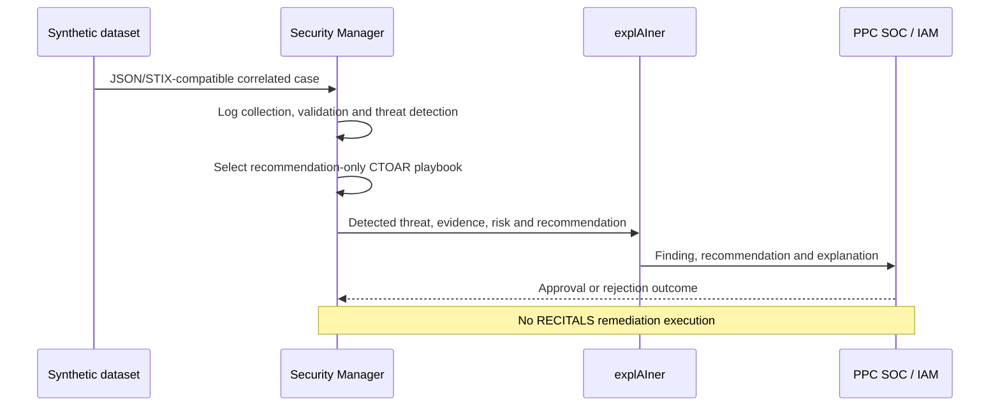

# RECITALS PPC Use Case — Two-Scenario Pilot Proposal

**Version:** 1.10  
**Date:** 24 July 2026  
**Use case:** Complex, effective and efficient identity management in the energy sector  
**Scenario 1:** Identity management of PPC employees and external collaborators  
**Scenario 2:** Detection of anomalous privilege escalation with a human-reviewed remediation recommendation

## 1. Purpose and scope

PPC requires a secure and scalable identity-management approach for employees and external collaborators whose roles and permissions change frequently across cloud, on-premises and business applications. RECITALS is proposed as a privacy-enhancing layer that can support identity lifecycle management, policy validation, security-event assessment and reporting while integrating with PPC's existing systems.

The two pilot scenarios are:

1. **Scenario 1 — Identity management of PPC employees and external collaborators:** validates Joiner, Mover, Leaver, access-request, approval, policy and review workflows.
2. **Scenario 2 — Anomalous privilege escalation:** validates detection, explanation and a remediation recommendation reviewed by PPC IAM/SOC.

PPC's existing platforms retain their operational authority:

- SuccessFactors remains authoritative for employment and contract lifecycle events.
- ServiceNow or Entra Governance remains the request/approval workflow where applicable.
- Microsoft Entra ID, AD and business applications remain identity/access systems and enforcement points.
- The shared synthetic Microsoft Sentinel dataset provides supporting security/audit evidence for both scenarios; Microsoft Sentinel is not a RECITALS runtime component, output destination or approval step in Scenario 2.
- RECITALS normalizes and evaluates the supplied context, applies configured policies, explains decisions and generates reports or recommendations.

## 2. Data and integration approach

### 2.1 Synthetic datasets and supporting data catalog

No Normalized JSON adapter is included in the pilot component setup. The provided synthetic datasets directly play the role of normalized workflow input and are submitted to the agreed RECITALS receiving interface.

The two primary synthetic workflow payloads and the two supporting data artifacts are:

| Dataset | Type and short description | Used by |
|---|---|---|
| [Scenario 1 normalized JSON](../recitals_scenario1_compact_normalized_dataset.json) | Primary synthetic workflow payload with 12 already-correlated Joiner, Mover, Leaver, access-governance, review and exception cases. It is submitted directly to the Identity Lifecycle Manager. | Scenario 1 |
| [Scenario 2 correlated JSON](../recitals_scenario2_correlated_dataset.json) | Primary synthetic workflow payload with 11 benign, malicious and false-positive privilege-escalation bundles containing already-correlated identity and security evidence. It is submitted directly to Security Manager — Log Collection. | Scenario 2 |
| [Microsoft Entra ID synthetic log scenarios](../entra_id_user_scenarios.md) | Supporting catalog of representative Entra `AuditLogs`, sign-in, role, group, PIM, Conditional Access, application and malicious-activity records. It provides source-level samples for building or validating the normalized workflow payloads. | Scenarios 1 and 2 |
| [Shared Microsoft Sentinel synthetic dataset](../RECITALS_Shared_Sentinel_Dataset_Scenarios_1_and_2.md) | Shared synthetic evidence input with 12 correlated `AuditLogs`, `SigninLogs`, `IdentityInfo`, `SecurityAlert` and `SecurityIncident` bundles. Eight bundles support Scenario 1 lifecycle/security validation and eight support Scenario 2 detection, including four cross-scenario cases. | Scenarios 1 and 2 |

The two JSON datasets serve as the primary synthetic pilot inputs and example interface contracts. The Entra ID and shared Sentinel Markdown datasets provide additional source-level and correlated evidence for both scenarios. For Scenario 2, the selected Sentinel-derived bundles are supplied as synthetic input directly to the agreed Security Manager receiving interface; Microsoft Sentinel is not deployed or integrated as a RECITALS workflow component. Live PPC source integration is a later activity and is not part of this synthetic-data pilot.

For evaluation, the files contain expected-result fields. `ground_truth`, `expected_recitals` and equivalent answer labels.

### 2.2 Source responsibilities

| Data category | Primary source | Use by RECITALS |
|---|---|---|
| Employee lifecycle | PPC Success factors | Joiner, Mover, Leaver, role, department, manager and effective date |
| External-collaborator lifecycle | Contractor/vendor source | Sponsor, organization, contract, start/end date and allowed scope |
| Access request and approval | ServiceNow or Entra Governance | Request, approvers, decisions, justification and validity |
| Identity and access state | Entra ID, AD and application APIs | Current account, groups, roles, licenses and entitlements |
| Access policy and role mapping | IGA/policy repository, Entra Governance and application owners | Birthright access, RBAC, least privilege, SoD and PIM rules |
| Access review | Entra Governance, IGA or ServiceNow | Review scope, reviewer and retain/revoke decision |
| Security/audit evidence for Scenario 1 | Shared Sentinel dataset, Entra logs and Defender | Verify lifecycle execution, resulting identity state, suspicious exceptions and audit evidence |
| Correlated security evidence for Scenario 2 | Scenario 2 JSON and selected bundles from the shared Sentinel dataset | Supply already-correlated sign-in, privilege-change, alert and incident evidence to Security Manager for detection and recommendation-only HITL |
| Device inventory | PPC IT systems | Device identity, owner, status and access relationship where in scope |

The shared Sentinel dataset is supporting evidence only. It is not authoritative for employment status, access requests, approvals or role mappings, and it does not make Microsoft Sentinel a Scenario 2 component.

### 2.3 Alignment with the RECITALS integration matrix

The supplied **Tech Requirements and Pilots - Integration** matrix changes how the pilot workflows should be represented:

- Keycloak-issued `USER_TOKEN`/`SERVICE_TOKEN` values are the expected authorization mechanism, with ILM identified as the related authorization integration point for the LLM-based Interface and explAIner.
- The Compliance Manager is an **offline component**. It consumes execution logs from core components and generates compliance reports on request; it is not confirmed as a synchronous decision gate between ILM and Security Manager.
- The LLM-based Interface integrates approved documentation and API descriptions from all core components and services. It should not be shown only as the final recipient of a Reporting Engine output.
- Security Manager provides detected-threat information to explAIner.
- explAIner is described as a **Phase 2** integration. Its integration with the Compliance Manager remains unclear.
- Security Manager-to-ILM integration is explicitly unresolved in the matrix.
- Reporting Engine is listed in the original PPC use case, but it is not defined in the supplied integration matrix. Its deployability, API and ownership remain to be confirmed.

Accordingly, the diagrams below distinguish the confirmed or documented integration direction from proposed pilot handoffs that still require RECITALS validation.

## 3. Scenario 1 — Identity Management of PPC Employees and External Collaborators

### 3.1 Business problem and objective

PPC manages more than 20,000 employees and thousands of external collaborators across hundreds of systems, including SCADA, ERP, cloud analytics and employee/customer applications. Frequent organizational movement and third-party access create delays, inconsistent permissions, administrative overhead and security/compliance risk.

Scenario 1 aims to provide a unified identity-lifecycle view and controlled workflows for:

- Employee and external-collaborator onboarding and offboarding
- Internal role, department and responsibility changes
- RBAC and permissions management
- Segregation of duties and least-privilege checks
- Access requests, approvals and time-bound access
- Access review and recertification
- Audit evidence and reporting
- SIEM integration for security monitoring

The broader source scenario also identifies distributed verifiable identity, distributed ledger, privacy-preserving authentication/authorization, biometric proof of employee identity, device lifecycle, customer lifecycle and extensive reporting as target capabilities. These require separate interface, legal, privacy and technical validation before they can be included in the pilot.

### 3.2 Actors

- PPC employees
- PPC external collaborators, subcontractors and subsidiary personnel
- PPC HR
- PPC IAM administrators
- Managers and application/resource owners
- PPC SOC
- PPC IT/device owners where device identity is included
- National cybersecurity authorities such as NCSA/CSIRT when a notifiable incident occurs

Customers and customer lifecycle are part of the broader use case, but not part of this initial Scenario 1 employee/collaborator dataset.

### 3.3 Light pilot

The light pilot validates the minimum functional Joiner/Mover/Leaver workflow using synthetic normalized data.

#### Minimum RECITALS functions

| Function/component | Pilot responsibility |
|---|---|
| Identity Lifecycle Manager | Validate identity lifecycle events, compare current and required access, and produce lifecycle actions |
| Compliance/policy checks — minimal | Apply agreed RBAC, mandatory-field, approval, contractor-expiry and SoD rules |
| Reporting/audit output | Record inputs, decisions, requested changes, results and exceptions |

#### Light workflow

For sensitive or privileged access, the required manager/application-owner/IAM approval must be recorded before execution. Ordinary approved lifecycle provisioning is distinct from Scenario 2 security remediation.

#### Light dataset cases

- Valid employee onboarding
- Time-bound contractor onboarding
- Joiner rejected for missing mandatory data
- Employee Mover with old-access removal
- Employee termination/offboarding
- Contractor expiry/offboarding
- Partial provisioning failure and rollback

### 3.4 Extended Scenario

The Extended Scenario adds lifecycle validation, offline compliance reporting, security assessment, explanation, reporting and a natural-language interface. The Scenario 1 synthetic dataset is submitted directly to the relevant RECITALS receiving interfaces; no adapter or separate record-linkage component is included.

The earlier fully linear chain has been replaced because it was not supported by the integration matrix. The revised design has:

- a lifecycle-processing path through ILM;
- a security-processing path through Security Manager;
- an offline log-to-compliance-report path;
- a Phase 2 explanation path from Security Manager to explAIner; and
- an authorized LLM interface over approved component APIs, documentation and generated results.

#### Selected RECITALS components and integration role

| RECITALS component | Minimum input | Pilot output | Integration status |
|---|---|---|---|
| Identity Lifecycle Manager | Subject/lifecycle data, current access, requested change and applicable lifecycle/access rules | Lifecycle action candidate and execution log | Primary Scenario 1 component; Security Manager integration remains TBC |
| Compliance Manager | Agreed execution-log schema from ILM, Security Manager and other participating components | On-request compliance assessment/report | Offline consumer; required log fields and ingestion method are TBC |
| Security Manager - Cyber-threat Detector | Security evidence and the minimum identity context needed for correlation | Normal/suspicious classification, risk, confidence, evidence references and execution log | Direct ILM handoff is not confirmed; synthetic security context is supplied directly for the pilot |
| explAIner | Detected threat, evidence, risk and confidence from Security Manager | Human-readable explanation | Security Manager integration is identified; delivery is planned for Phase 2 |
| Reporting Engine | Validated component results and human decisions | Structured PPC case/audit report | Listed in the PPC use case but absent from the integration matrix; optional until RECITALS confirms an implemented service |
| LLM-based Interface | Authorized query, approved API/documentation sources and permitted case/report results | Grounded case summary or user guidance with references | Keycloak/ILM authorization and integration with all approved component/API documentation |

Cryptography Manager, Anonymization Manager, Distributed Ledger and Self-Sovereign Wallet remain outside this pilot workflow. Because only synthetic data is used, additional anonymization is not required for this test.

The LLM-based Interface is a presentation and guidance layer. It does not calculate lifecycle or compliance decisions, change risk scores, approve requests or execute identity actions. Its answers must be grounded in authorized component results and approved RECITALS documentation. If the Reporting Engine is not independently available, ILM, Compliance Manager, Security Manager and explAIner results may be exposed directly to the LLM interface through agreed read-only interfaces.

#### Minimum workflow input

Each synthetic case must provide only the following information:

| Input group | Minimum fields | Purpose |
|---|---|---|
| Case metadata | `case_id`, event type, source and effective timestamp | Correlation and workflow selection |
| Subject and lifecycle | Stable subject ID, employee/collaborator type, employment status, department/role, manager or sponsor, and contract end date when applicable | Subject correlation, data validation and Joiner/Mover/Leaver decision |
| Access context | Current account status and entitlements; requested account/group/role change and validity period | Calculate the required access delta |
| Governance context | Approval required/decision/approver plus applicable role profile, SoD and expiry rules | Compliance decision |
| Security context | Risk indicator and evidence references; optional for normal cases and required for security-exception cases | Security classification and SOC traceability |
| Execution-log context | `case_id`, component/service metadata, status/exit status, timestamp and result reference | Minimum proposed input for offline Compliance Manager reporting; final schema TBC |
| LLM interaction context | Keycloak-issued token context, authorized user/role, natural-language query, permitted component/document/result reference and requested response language | Scope and access-control context for a grounded conversational answer |

`ground_truth`, `expected_recitals` and equivalent expected-result fields are test labels. They are used by the test harness to compare results and must not be exposed to RECITALS while it evaluates the case.

#### Component diagram

The LLM-based Interface uses authorized read-only access to approved component APIs, documentation and result sources. Reporting Engine may provide a consolidated result source if RECITALS confirms that it exists as a deployable component; it is not a mandatory processing dependency.

#### Call flow - lifecycle and offline compliance

#### Call flow - security, Phase 2 explanation and user interface

Neither the Reporting Engine nor the LLM-based Interface provisions or revokes access. Any operational change is performed through PPC's existing approved IAM or application-owner process. The direct ILM-to-Security Manager interface is not part of the PoC unless RECITALS confirms and tests it.

#### Extended Scenario cases

- Access request blocked by an SoD conflict
- Approved time-bound PIM access
- Privileged-access review/recertification
- Possible duplicate identity requiring reconciliation
- Unauthorized privilege change with shared Sentinel/Defender-derived evidence

### 3.5 Scenario 1 outputs and responsible PPC teams

| Output | Originating RECITALS component | Minimum contents | Responsible PPC team |
|---|---|---|---|
| Identity-data exception | Identity Lifecycle Manager | Subject, missing/conflicting fields, affected source record and review reason | PPC IAM; PPC HR consulted when authoritative identity data must be corrected |
| Lifecycle decision | Identity Lifecycle Manager | Create/modify/revoke/retain/reject/hold, target access and effective period | PPC IAM and relevant application owner |
| Compliance report | Compliance Manager | Components/logs assessed, applicable requirements, result and evidence gaps | PPC IAM Governance, Security Governance and auditors |
| Security exception | Cyber-threat Detector | Affected identity, classification, risk score and evidence references | PPC SOC, with PPC IAM consulted |
| Human-readable reason | explAIner | Concise explanation of the lifecycle, policy and security results | PPC IAM, IAM Governance or SOC according to the case |
| Audit and case report | Reporting Engine | `case_id`, inputs used, component results, human decision, status and timestamps | PPC IAM Governance, Security Governance and auditors |
| Conversational case summary or guidance | LLM-based Interface | Authorized query, concise grounded response, source/report references and no unsupported action | PPC IAM, IAM Governance, HR, application owners or auditors according to access rights |

### 3.6 Scenario 1 evaluation

The official use-case targets remain:

- At least **30% reduction** in identity-lifecycle operational time and FTE effort
- Increased administrator usability
- Improved reporting
- At least **20% improvement** in cyberthreat detection and mitigation accuracy at broader use-case level
- At least **20% increase** in cyberthreat information shared through EE-ISAC at broader use-case level

For a compact pilot, measure:

| KPI | Pilot measure |
|---|---|
| Workflow correctness | Correct decision and requested changes for each labeled case |
| Provisioning success | Successful target operations / attempted operations |
| End-to-end lifecycle time | Event receipt to completed or exception state |
| Manual effort | Number and duration of human steps per case |
| Access-removal completeness | Obsolete entitlements removed for Mover/Leaver cases |
| Policy accuracy | Correct SoD, approval and expiry outcomes |
| Audit completeness | Traceable source, decision, approval and execution evidence |
| LLM answer groundedness | Answers are supported by the authorized report/document sources and include traceable references |
| LLM usability | PPC users can retrieve the required case status or guidance without specialist RECITALS knowledge |

The claim that only two administrators will operate the final platform should be treated as a target to validate, not a pilot acceptance criterion.

## 4. Scenario 2

### 4.1 Scope

Scenario 2 is the recommendation-only HITL workflow for anomalous privilege escalation. It uses an already-correlated synthetic JSON dataset containing Entra ID, Defender and AD evidence and may also use the Scenario 2-labelled bundles from the shared synthetic Sentinel dataset. These bundles are test input, not a Microsoft Sentinel runtime integration. RECITALS creates a security assessment and recommends a response playbook directly to PPC SOC/IAM for human review. RECITALS does not execute a remediation command.

The Security Manager specifications describe JSON/STIX 2.1, REST/WebSocket, MQTT/RabbitMQ, SQL and filesystem integration, while another supplied version specifies PCAP as the detector input. RECITALS must therefore confirm a native JSON/STIX-compatible ingestion path for the supplied dataset. No new adapter is included in the PoC.

### 4.2 Components and responsibilities

| Component or actor | Responsibility |
|---|---|
| Security Manager — Log Collection | Receive and validate the synthetic correlated security case |
| Security Manager — Cyber-threat Detector | Evaluate evidence and calculate finding severity, risk and confidence |
| Security Manager — CTOAR | Select the appropriate response playbook and produce the remediation recommendation |
| explAIner | Explain the detected threat, evidence, risk and recommendation in human-readable form; Phase 2 readiness dependency |
| PPC SOC/IAM | Review the finding and approve or reject the recommendation |

Log Collection, Cyber-threat Detector and CTOAR are logical services within Security Manager. The physical deployment may be one or several images/processes; RECITALS must provide the actual packaging instead of PPC assuming three independent deployable components.

### 4.3 Component diagram

The Compliance Manager branch is non-blocking and outside the Scenario 2 decision path. It is included only because the integration matrix expects Security Manager execution logs to support offline compliance reports. The final log schema and whether this branch is required for the PoC remain TBC.

### 4.4 Outputs and HITL boundary

| Output | Contents | Responsible PPC team |
|---|---|---|
| Security finding | Affected user, changed privilege, actor, timestamp, source IP, correlated events, risk score and reason | PPC SOC, with PPC IAM consulted to validate the privilege change |
| Human-readable reason | Explanation of the triggered rules, evidence, risk and context | PPC SOC and PPC IAM |
| IAM investigation request | User, role change and authorization question | PPC IAM |

The only remediation-related output in scope is:

| Output | Primary RECITALS component | Supporting RECITALS components | Human owner |
|---|---|---|---|
| **Remediation recommendation** | **Security Manager — CTOAR selects the appropriate response playbook** | **Cyber-threat Detector supplies risk/confidence; explAIner explains the recommendation** | **PPC IAM/SOC reviews and approves/rejects** |

Example human-readable reason:

> High-risk privilege escalation detected because the Global Administrator role was assigned outside the approved change window by an unexpected administrator following a sign-in from an unfamiliar IP address.

### 4.5 Call flow

If explAIner is not available in the PoC phase, Security Manager must still return a concise rule/evidence-based reason. This fallback validates detection but does not count as completion of the full four-function Scenario 2 workflow.

Recommendations may include revoking sessions, removing only the newly assigned role, requiring reauthentication/MFA, temporarily disabling the account or investigating the managed device. Any approved operational action is performed through PPC's existing process outside the RECITALS pilot.

### 4.6 Scenario 2 detection cases

- Approved PIM activation
- Direct role escalation
- Password attack followed by escalation
- MFA fatigue followed by PIM activation
- Conditional Access tampering
- Service-principal privilege escalation
- Guest privilege escalation
- Hybrid AD Domain Admin escalation
- Defender-confirmed compromised device
- Disabled/leaver-account abuse
- Approved emergency change/false-positive control

### 4.7 Scenario 2 KPIs

| KPI | Pilot measure |
|---|---|
| Detection accuracy | Compare results with labeled synthetic cases |
| False-positive rate | Measure against approved/benign control cases |
| Detection latency | Payload receipt to security finding |
| Severity/risk quality | Compare severity and score with expected results |
| Evidence traceability | Each finding references the evidence used |
| Reason completeness | Each finding includes a readable rule/evidence-based reason |
| Recommendation quality | Appropriate, justified and preferably reversible response |
| HITL enforcement | Every recommendation is reviewed by PPC IAM/SOC |
| Unauthorized RECITALS execution | Zero remediation commands issued by RECITALS |

## 5. Security, privacy and compliance constraints

- Apply GDPR data minimization and purpose limitation; use synthetic or pseudonymized data for the initial pilot.
- Do not transfer passwords, secrets, access tokens, raw biometric templates or unrelated personal data.
- Define retention, deletion, encryption, access control and audit requirements before live PPC data is used.
- Align integrations with PPC's Zero Trust model and NIS2 requirements. The PoC does not require APIM.
- Assess DORA applicability for the selected systems and processing context rather than assuming it applies to every pilot flow.
- Biometric employee-identity proof requires a dedicated necessity/proportionality assessment, DPIA, lawful-basis decision, liveness/accuracy testing and explicit architecture before inclusion.
- Notification to NCSA/CSIRT and sharing through EE-ISAC must follow PPC's existing incident-classification and approval processes.

## 6. Technical environment and non-functional validation

The pilot must account for PPC's heterogeneous environment: AD/on-premises systems, Azure, OCI, GCP, IBM Cloud, Oracle, MySQL, Microsoft SQL and Cosmos DB. Any observability integration required beyond the two defined workflows must be specified separately.

The test plan should measure response time, throughput, latency, replication time/load where relevant, functional accuracy, failure recovery and audit completeness. Scale claims for the full PPC population must not be inferred from the compact datasets; separate volume, performance and resilience tests are required.

### 6.1 Preliminary component-level hardware requirements

RECITALS has supplied the following preliminary hardware baselines. These values reduce the sizing uncertainty, but they do not yet define the final deployment topology or prove that the combined services fit the three available PPC testbed VMs.

| Component | Responsible partner | Supplied hardware requirement | Scenario relevance |
|---|---|---|---|
| Identity Lifecycle Manager | PPC | 1 VM: 4 vCPU, 16 GB RAM, 200 GiB disk | Scenario 1 |
| Compliance Manager | TCD | 1 VM: 4 vCPU, 32 GB RAM, 500 GiB disk | Scenario 1; optional offline branch for Scenario 2 if agreed |
| Security Manager | TUD+PDM | 1 VM: 16 vCPU, 64 GB RAM, 1 TB disk | Scenarios 1 and 2 |
| LLM-based Interface — CPU option | PPC | 1 VM: 16 vCPU, 64 GB RAM, 300 GiB disk | Scenario 1 Extended Scenario |
| LLM-based Interface — GPU option | PPC | 1 GPU VM: 16 vCPU, 64 GB RAM, NVIDIA L4 24 GB GDDR6, 375 GiB disk | Scenario 1 Extended Scenario, if the GPU deployment is selected |
| explAIner using LUH-hosted LLM | LUH | No local GPU required; approximately 2–4 GB RAM and stable connectivity to the LUH LLM service | Scenarios 1 and 2, Phase 2 |
| explAIner with local LLM | LUH | High-end CPU/GPU required; exact local sizing not supplied | Only if local LLM deployment is required |
| Reporting Engine | TBC | No sizing supplied in the received table | Scenario 1, optional until component availability is confirmed |

For Scenario 2, no separate hardware values are supplied for Log Collection, Cyber-threat Detector and CTOAR. RECITALS must confirm whether these logical functions and their databases, queues or other dependencies are included within the **Security Manager 16 vCPU / 64 GB RAM / 1 TB** baseline.

The remaining deployment work is to map the selected packages to the actual PPC VMs; confirm their current machine types and capacities; aggregate resources for any co-hosted services; and define the operating system, container/runtime, ports, dependencies, DNS/service discovery, network flows and component/version baseline.

## 7. Open gaps and decisions

| Gap or decision | Required action |
|---|---|
| RECITALS component interactions remain insufficiently defined | Agree component ownership, APIs, state transitions and error handling for each scenario |
| Compliance Manager is offline | Define execution-log producers, required fields, transfer method and on-request report contract |
| Security Manager-to-ILM integration is unresolved | Do not make it a PoC dependency until RECITALS confirms and tests the interface |
| No synchronous RBAC/SoD policy gate is confirmed | Confirm whether ILM applies the blocking lifecycle/access rules or identify another service; do not use the offline Compliance Manager as an assumed runtime gate |
| explAIner is identified as Phase 2 | Provide its artifact/readiness date; use a Security Manager reason only as an interim fallback |
| Security Manager input specifications conflict | Confirm that the supplied correlated JSON can be consumed natively through JSON/STIX REST/file/SQL ingestion; PCAP-only input is insufficient |
| No confirmed Scenario 1 ingestion/provisioning interfaces | Agree how RECITALS receives lifecycle events and how approved actions reach Entra ID/AD/applications |
| No confirmed Scenario 2 ingestion or PPC human-review interface | Start with the normalized dataset; agree the receiving API and the channel through which PPC SOC/IAM receives and records its review |
| Datasets are example contracts | Formalize JSON Schema/OpenAPI, required fields, enums, authentication, idempotency and error responses |
| Access-policy source is not confirmed | Identify the authoritative PPC RBAC/SoD/profile repository and owners |
| Human review channel is not confirmed | Decide whether reviews are recorded in ServiceNow, Entra Governance or a pilot UI |
| Distributed Ledger/verifiable identity value and interface are unclear | Define a bounded experiment and acceptance criteria before making them dependencies |
| Biometric proof is underspecified and high risk | Keep out of the initial pilot pending legal, privacy, security and architecture approval |
| Reporting Engine is absent from the integration matrix | Confirm whether it is an implemented deployable component; otherwise use direct component results and Compliance Manager reports |
| LLM-based Interface integration with live case reports is not confirmed | Confirm its API, authorization model, supported query/report formats, grounding sources, response references, model/runtime requirements and end-to-end readiness |
| Preliminary component sizing exists, but final placement and combined capacity fit are not confirmed | Map packages and supplied baselines to the three PPC VMs; confirm actual VM capacities, co-hosting assumptions and whether Security Manager sizing includes Log Collection, Cyber-threat Detector, CTOAR and supporting services |
| explAIner deployment mode is not selected | Confirm whether the PoC uses the LUH-hosted LLM service or a local model; provide the final CPU/disk or GPU requirement and the required network, authentication and data-processing controls |
| Synthetic datasets are not scale tests | Create separate performance, resilience and privacy-validation datasets |

## 8. Recommended implementation order (If proposal is accepted, otherwise these steps to be followed on finalized proposal)

1. Agree the two normalized JSON contracts and the RECITALS receiving interfaces.
2. Run Scenario 1 light with the core Joiner/Mover/Leaver cases.
3. Validate lifecycle decisions, controlled provisioning, rollback and audit reporting.
4. Run the Scenario 1 Extended Scenario using the revised lifecycle, security, offline-compliance and authorized-interface paths.
5. Run Scenario 2 using the correlated security dataset and the complete recommendation-only HITL flow.
6. Validate detection, explanation and recommendation value and confirm the PPC SOC/IAM operating model.
7. Only after the synthetic flows are stable, design live PPC source integrations and larger-scale tests.
8. Evaluate Distributed Ledger, verifiable identity, wallet and biometric proof as separately governed extensions.

## 9. Scope conclusion

Scenario 1 is **identity management of PPC employees and external collaborators**, implemented first as a compact Joiner/Mover/Leaver pilot and then as the integration-aligned **Extended Scenario**, including the LLM-based Interface. Scenario 2 is the **security detection and recommendation-only HITL** flow for anomalous privilege escalation.

The security boundary remains explicit: **Security Manager — CTOAR selects the response playbook; Cyber-threat Detector supplies risk/confidence; explAIner explains the recommendation; PPC IAM/SOC approves or rejects. RECITALS does not execute the remediation action.**
