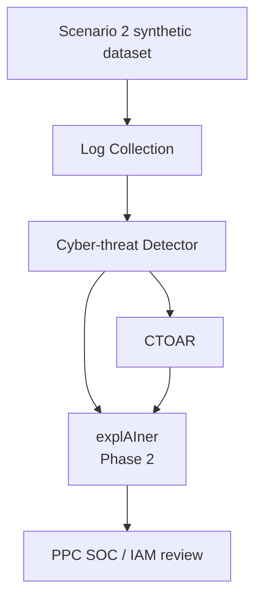
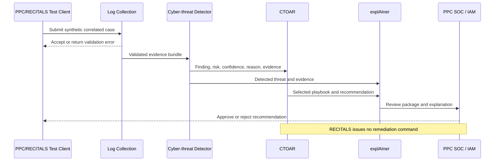
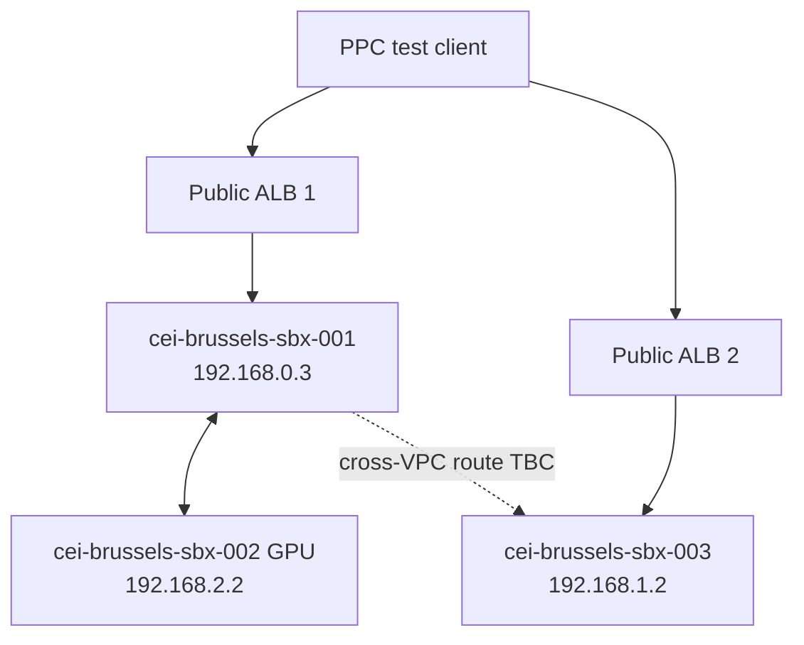

# RECITALS Scenario 2 — PoC Low-Level Design (LLD)

**Document status:** Draft for RECITALS review and completion  
**Version:** 0.4  
**Date:** 24 July 2026  
**Scenario:** Anomalous privilege escalation with human-reviewed remediation recommendation  
**Purpose:** Temporary PoC deployment and end-to-end validation

> This LLD defines only the minimum design needed to deploy and test Scenario 2 with synthetic data. It is not a production design. Values marked **TBC by RECITALS** must be completed before PPC provides a PoC environment or begins testing.

## 1. Document control

### 1.1 Revision history

| Version | Date | Author/owner | Change | Status |
|---|---|---|---|---|
| 0.1 | 24 July 2026 | PPC draft / RECITALS to complete | An example of low level design document| For demo |

## 2. Purpose and PoC boundary

Scenario 2 validates that RECITALS can process an already-correlated synthetic identity-security case and provide a traceable remediation recommendation for PPC SOC/IAM review.

### In scope

- Direct submission of `recitals_scenario2_correlated_dataset.json`.
- Security Manager — Log Collection.
- Security Manager — Cyber-threat Detector.
- Security Manager — CTOAR.
- explAIner.
- Direct presentation of the result to PPC SOC/IAM through an agreed PoC interface.
- Human approval or rejection without action execution.
- End-to-end testing of the 11 synthetic cases.
- Use of the three existing PPC testbed VMs without rebuilding them.

### Out of scope

- Live PPC source integrations.
- Automatic remediation or changes to PPC accounts, roles, sessions, passwords, devices, or policies.
- Production deployment and production data.
- Functions not required to demonstrate the four-component Scenario 2 workflow.

## 3. Inputs and expected outputs

### 3.1 Supplied input

| Item | Description |
|---|---|
| `RECITALS_PPC_Usecases.md` | Agreed PPC scenario, component flow, responsibilities, and human-review boundary |
| `recitals_scenario2_correlated_dataset.json` | Synthetic payload with 11 benign, malicious, and false-positive privilege-escalation cases |
| RECITALS component specifications | Available descriptions for Security Manager and explAIner; technical details remain to be confirmed |
| `Tech Requirements and Pilots - Integration.pdf` | Integration ownership and direction, including Keycloak/ILM authorization, Security Manager-to-explAIner handoff, offline Compliance Manager logging, and Phase 2 status of explAIner |

The synthetic JSON is submitted directly to Log Collection. No normalization component is required for the PoC.

RECITALS must confirm that Security Manager can consume the supplied correlated JSON through one of its documented JSON/STIX 2.1 REST, file, SQL or messaging interfaces. A separate supplied specification describes PCAP as the detector input; a PCAP-only interface is not compatible with this PoC dataset.

### 3.2 Minimum input data per case

| Data group | Minimum content |
|---|---|
| Case identity | `batch_id`, `bundle_id`, scenario, category, start time, and end time |
| Subject | User/service identity, identity type, current state, and existing privilege |
| Privilege event | Changed role/group, action, actor, timestamp, and approval/change context where available |
| Security evidence | Sign-in, audit, PIM, directory, device, authentication, source IP, and correlation identifiers as applicable |
| Reference context | Critical roles, trusted locations, normal hours/devices, approved change window, and break-glass accounts |
| Evaluation labels | `ground_truth` and `expected_recitals` are used only for test scoring and must not be supplied to the components during inference |

### 3.3 Required PoC output

Each result must contain:

- `batch_id` and `bundle_id`.
- Finding type and detection decision.
- Severity, risk score, and confidence.
- Affected identity, changed privilege, actor, time, and relevant evidence references.
- Human-readable reason.
- CTOAR-selected playbook identifier and remediation recommendation.
- Human-review state: `pending_review`, `approved`, or `rejected`.
- Explicit `automatic_execution: false` indication.
- Component versions and error details when processing fails.

## 4. Logical design

### 4.1 Component responsibilities

| Order | RECITALS component | Minimum input | Output | Next recipient |
|---:|---|---|---|---|
| 1 | Security Manager — Log Collection | Synthetic correlated case | Validated evidence bundle or validation error | Cyber-threat Detector |
| 2 | Security Manager — Cyber-threat Detector | Validated evidence and reference context | Finding, severity, risk, confidence, reason, and evidence references | CTOAR |
| 3 | Security Manager — CTOAR | Finding and risk assessment | Selected playbook and recommendation only | explAIner |
| 4 | explAIner | Finding, evidence, risk, and selected playbook | Human-readable explanation and consolidated review package | PPC SOC/IAM |

Log Collection, Cyber-threat Detector and CTOAR are logical Security Manager services. They must not be treated as three separate VMs or containers unless the RECITALS deployment package requires that topology. explAIner is identified in the integration matrix as a Phase 2 integration and is therefore a readiness dependency for the complete four-function workflow.

### 4.2 Component diagram

### 4.3 Call flow

If explAIner is not available during the first PoC phase, Cyber-threat Detector must still provide a concise rule/evidence-based reason. This fallback may validate Security Manager, but it does not satisfy acceptance of the complete four-function Scenario 2 workflow.

## 5. PoC interfaces

RECITALS must confirm whether the synthetic payload is submitted through an HTTP endpoint, command-line runner, or mounted file. HTTP is preferred when already supported, but PPC does not require a new gateway for the PoC.

| Property | Proposed PoC value | RECITALS response |
|---|---|---|
| Input method | HTTP `POST`, CLI, or mounted JSON file | TBC |
| HTTP path, if used | `/api/v1/security/correlated-events/batch` | TBC |
| Content type | `application/json` | TBC |
| Authentication | TBC according to selected isolated environment | TBC |
| Correlation | `batch_id` and `bundle_id` | TBC |
| Response | Accepted/rejected status and validation errors | TBC |
| Result delivery | Direct API response, result file, or simple PoC UI | TBC |

For each component handoff, RECITALS must provide the request/event schema, response schema, error behavior, and one working example.

Where explAIner or another RECITALS service uses the common platform authorization flow, it must accept the agreed Keycloak-issued `USER_TOKEN` or `SERVICE_TOKEN`, with the ILM-related authorization integration completed by RECITALS.

## 6. Deployment and infrastructure

### 6.1 PoC placement and public entry

- Public ALBs are expected for the services hosted on `cei-brussels-sbx-001` and `cei-brussels-sbx-003`.
- Each ALB must forward application/API traffic to the VM's **internal IP**, not its external IP.
- Valid application/API ports are limited to the required subset of `80`, `443`, `8000`, `8080` and `11434`.
- Port `22` must not be exposed through either ALB.
- SSH/administration must use IAP, bastion, VPN or temporary source-whitelisted direct SSH.
- Internal communication between `cei-brussels-sbx-001` and `cei-brussels-sbx-002` should use their private IPs within the common VPC.
- Any flow to `cei-brussels-sbx-003` crosses the VPC boundary and requires an explicitly approved routing/peering and firewall design.
- RECITALS must map its deployable images/processes to these VMs. PPC does not assume one VM per logical Security Manager service.

### 6.2 Preliminary Hardware Baseline and Deployment Inventory

| Logical function | Responsible partner | Supplied hardware requirement | Items still to confirm |
|---|---|---|---|
| Security Manager, including Scenario 2 Log Collection, Cyber-threat Detector and CTOAR functions if packaged together | TUD + PDM | \*\*1 VM: 16 vCPU, 64 GB RAM, 1 TB disk\*\* | Confirm that all logical functions and supporting services are covered by this baseline. Provide the image/package, OS/runtime, ports and storage layout. |
| explAIner using the LUH-hosted LLM service | LUH | \*\*No local GPU required; approximately 2–4 GB RAM and stable connectivity\*\* to the LUH-hosted LLM service | Confirm CPU and disk requirements, service endpoint, network route, TLS/authentication, data-processing location and service availability. |
| explAIner with a locally deployed LLM, if required | LUH | \*\*High-end CPU/GPU required; exact sizing not supplied\*\* | Confirm whether local deployment is required. If so, provide CPU, RAM, disk, GPU model/VRAM, LLM model and runtime requirements. |
| Required database, queue or other shared service | TBC | \*\*Not separately supplied\*\* | Confirm whether these services are included in the Security Manager baseline or require additional infrastructure. |
| PoC result/review interface | TBC | \*\*Not separately supplied\*\* | Confirm whether the interface is included within an existing component or requires an additional deployment. |

RECITALS must also identify the supported OS/container runtime, component and image versions, registry access, database/queue/model dependencies, configuration values, internal endpoints and final placement. If explAIner uses the LUH-hosted LLM service, the PPC security and architecture review must confirm that the proposed network and data-processing path is acceptable.

### 6.3 Connectivity matrix

| Source | Destination | Protocol/port | Authentication | Purpose |
|---|---|---|---|---|
| PPC test client | Public ALB DNS - TBC | HTTPS/443 preferred | TBC | Submit synthetic case or access PoC result UI |
| ALB 1 | `192.168.0.3` | Required subset of `80/443/8000/8080/11434` | TBC | Application/API traffic to `cei-brussels-sbx-001` |
| ALB 2 | `192.168.1.2` | Required subset of `80/443/8000/8080/11434` | TBC | Application/API traffic to `cei-brussels-sbx-003` |
| `192.168.0.3` | `192.168.2.2` | TBC | Service token or mTLS - TBC | Private inter-component/model flow inside common VPC |
| Common VPC VMs | `192.168.1.2` | TBC; only if required | TBC | Cross-VPC component flow; routing/firewall approval required |
| Authorized administrator | VM administration endpoint | SSH/22 outside ALBs | IAP, bastion, VPN or temporary source whitelist | Controlled administration |
| Components | Required approved model/artifact service, if any | TBC | TBC | Load approved dependency |

Undocumented external access will not be enabled.

## 7. Access, secrets, and data controls

- Use synthetic data for the PoC.
- Encrypt network traffic using TLS 1.2 or higher where HTTP is used.
- Define the user/group access required for RECITALS deployers and PPC reviewers.
- Use separate component credentials with minimum permissions; do not use shared administrator credentials.
- Store secrets outside source code, images, datasets, and deployment files.
- Identify any external LLM/model endpoint and confirm where prompts and outputs are processed.
- Use Keycloak-issued user/service tokens where required by the RECITALS integration design; document token audience, issuer, lifetime and validation.
- Do not use PPC data for model training.
- Remove evaluation labels before component execution.
- Define where input, intermediate results, recommendations, and human decisions are temporarily stored and how they are deleted after the PoC.

## 8. Deployment package

RECITALS must provide:

- Versioned Docker images or equivalent runnable packages.
- Docker Compose, Kubernetes manifests, or an equivalent repeatable setup.
- Configuration reference and sample values without secrets.
- Start, stop, clean redeployment, and troubleshooting instructions.
- Component compatibility and known limitations.
- One command or documented procedure to run all 11 cases end to end.

PPC provides infrastructure-level assistance only. Component deployment, configuration, integration, and debugging remain RECITALS responsibilities.

## 9. PoC test and acceptance

### 9.1 RECITALS readiness before PPC testing

RECITALS must demonstrate that:

1. All four components start with the delivered artifacts.
2. Every component handoff works in the selected environment.
3. The complete call flow processes the supplied dataset end to end.
4. Each case produces a traceable result or a controlled validation error.
5. Findings include risk, confidence, evidence, reason, and a playbook recommendation.
6. PPC SOC/IAM can review and record approval or rejection.
7. No RECITALS component executes remediation.
8. Known defects and limitations are documented.
9. The tested deployment uses the existing PPC VM allocation without rebuilding the VMs.
10. Application/API traffic uses the approved ALBs and private-IP backends; SSH is not exposed through the ALBs.

### 9.2 Test set

The 11 synthetic cases cover approved access, direct role escalation, password attack, MFA fatigue, policy tampering, service-principal escalation, guest escalation, hybrid AD escalation, compromised device, leaver-account abuse, and an approved emergency-change control.

### 9.3 Acceptance criteria

| Area | PoC acceptance |
|---|---|
| Deployment | Delivered artifacts reproduce the four-component setup |
| Dataset | All 11 cases are processed with per-case traceability |
| Detection | Result contains decision, severity, risk, confidence, reason, and evidence |
| Recommendation | CTOAR returns a relevant playbook recommendation |
| Explanation | explAIner produces an evidence-based human-readable explanation |
| Human review | PPC SOC/IAM can approve or reject the recommendation |
| Safety boundary | Zero remediation commands are issued by RECITALS |
| Error handling | Invalid input returns a clear validation error without silent loss |
| VM fit | RECITALS maps the supplied preliminary sizing to the three existing VMs and confirms that the combined CPU, RAM, disk and any GPU requirements fit their actual provisioned capacities |
| Network | Required same-VPC and cross-VPC flows are explicitly documented and tested |

## 10. Responsibilities and open items

### 10.1 Responsibility summary

| Activity | RECITALS | PPC |
|---|---|---|
| Confirm component mapping and technical workflow | Responsible | Review |
| Provide deployment artifacts and infrastructure requirements | Responsible | Review |
| Deploy, integrate, debug, and internally test the PoC | Responsible | Infrastructure support only |
| Provide the synthetic dataset and use-case expectations | Joint | Joint |
| Execute PPC validation after readiness confirmation | Support | Responsible |
| Execute any operational remediation | Out of scope | Existing PPC process only |

### 10.2 Required RECITALS responses

| ID | Required response | Owner | Due date |
|---|---|---|---|
| OI-01 | Confirm or correct the four-component workflow and named owners | RECITALS | TBC |
| OI-02 | State whether the workflow currently works end to end and provide evidence | RECITALS | TBC |
| OI-03 | If incomplete, provide missing items, dependencies, owners, and readiness dates | RECITALS | TBC |
| OI-04 | Confirm the input method and all component interface contracts | RECITALS | TBC |
| OI-05 | Confirm whether the supplied Security Manager baseline includes Log Collection, Cyber-threat Detector, CTOAR and all supporting services; complete remaining sizing, dependencies, placement and connectivity | RECITALS | TBC |
| OI-06 | Select the hosting option with PPC and provide the repeatable deployment package | RECITALS/PPC | TBC |
| OI-07 | Confirm the PPC SOC/IAM review interface | RECITALS/PPC | TBC |
| OI-08 | Map each package/process and the supplied hardware baselines to the three existing VMs; confirm actual VM capacity and total resource fit | RECITALS | TBC |
| OI-09 | Confirm same-VPC flows and whether cross-VPC communication with `cei-brussels-sbx-003` is required | RECITALS/PPC Infra | TBC |
| OI-10 | Confirm explAIner Phase 2 artifact/readiness date and Keycloak/ILM authorization flow | RECITALS | TBC |
| OI-11 | Confirm native JSON/STIX ingestion for the Scenario 2 dataset; PCAP-only input is not acceptable | RECITALS | TBC |

## 11. Approval condition

PPC PoC environment preparation and testing should start only after RECITALS:

1. Confirms the component workflow and interfaces.
2. Completes the minimum deployment and infrastructure information in this LLD.
3. Demonstrates the workflow end to end using the synthetic dataset.
4. Provides the deployable artifacts, test evidence, and known limitations.
