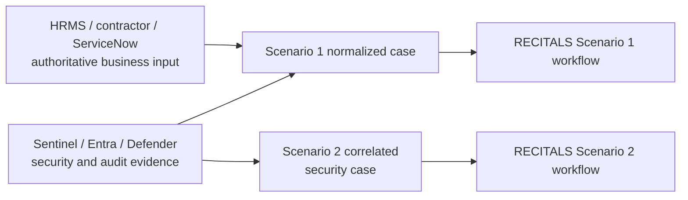

# RECITALS Shared Microsoft Sentinel Dataset for PPC Scenarios 1 and 2

**Version:** 1.1  
**Date:** 24 July 2026  
**Status:** Synthetic pilot dataset  
**Contains real PPC data:** No

## 1. Purpose

This compact dataset provides Microsoft Sentinel and Microsoft Entra evidence that can be reused by both PPC RECITALS scenarios:

- **Scenario 1 — Identity management of PPC employees and external collaborators:** Sentinel records verify account creation, group and role changes, account disablement, session revocation, access-review execution, PIM activity and security exceptions.
- **Scenario 2 — Anomalous privilege escalation:** Sentinel records support detection, correlation, risk/confidence calculation, human-readable explanation, CTOAR playbook selection and a remediation recommendation reviewed by PPC SOC/IAM.

The dataset is a **normalized projection of selected Sentinel/Log Analytics records**, not a raw workspace export. For the synthetic pilot it is supplied directly as supporting evidence; no Normalized JSON adapter is included. Its use in Scenario 2 does not introduce Microsoft Sentinel as a RECITALS component, output destination or approval step.

## 2. Important data boundary

Sentinel is not the authoritative source for employment status, access requests, approvals, business-role mappings or access-review decisions. Scenario 1 must correlate this dataset with the separate lifecycle dataset containing HRMS, contractor, ServiceNow/Entra Governance, policy and current-access inputs.



The dataset therefore supports:

- Scenario 1 execution verification and security-aware exceptions.
- Scenario 2 detection and recommendation-only HITL.
- Cross-scenario correlation through stable pseudonymous IDs, ticket references and correlation IDs.

It does **not** replace the Scenario 1 authoritative lifecycle payload.

## 3. Sentinel source projection

Only fields required for the pilot are retained.

| Sentinel/Log Analytics table | Selected source fields | Pilot use |
|---|---|---|
| `AuditLogs` | `TimeGenerated`, `Id`, `OperationName`, `Result`, `CorrelationId`, `InitiatedBy`, `TargetResources`, `AdditionalDetails` | Account, group, role, PIM, policy and session operations |
| `SigninLogs` | `TimeGenerated`, `Id`, `UserId`, `UserPrincipalName`, `IPAddress`, `Location`, `DeviceDetail`, `AuthenticationRequirement`, `ConditionalAccessStatus`, `RiskLevelDuringSignIn`, `ResultType`, `CorrelationId`, `SessionId` | Authentication, source, device, MFA, Conditional Access and sign-in risk |
| `IdentityInfo` | `TimeGenerated`, `AccountObjectId`, `EmployeeId`, `AccountUPN`, `UserType`, `IsAccountEnabled`, `AssignedRoles`, `GroupMembership`, `RiskLevel`, `BlastRadius` | Enriched identity state and role/group context where Sentinel UEBA is enabled |
| `SecurityAlert` | `TimeGenerated`, `SystemAlertId`, `AlertName`, `AlertSeverity`, `ConfidenceScore`, `CompromisedEntity`, `Entities`, `Tactics`, `Techniques`, `Status` | Detection and alert evidence |
| `SecurityIncident` | `TimeGenerated`, `IncidentNumber`, `IncidentName`, `Title`, `Severity`, `Status`, `AlertIds`, `Owner` | SOC incident context and human ownership |

Availability of fields such as Entra risk, PIM context and `IdentityInfo` depends on PPC licensing, connectors and diagnostic settings. The integration must confirm the actual PPC workspace schema before implementation.

## 4. Normalized bundle contract

Each `items[]` entry represents one already-correlated Sentinel evidence bundle.

| Field | Description |
|---|---|
| `bundle_id` | Stable synthetic bundle identifier |
| `used_by` | Scenario 1, Scenario 2 or both |
| `case_type` | Normalized event category |
| `business_reference` | Optional HR, ServiceNow, Entra Governance or change-ticket reference used only for correlation |
| `subject` | Pseudonymous affected identity |
| `actor` | Pseudonymous initiating identity or application |
| `event_window` | UTC start and end of the correlated activity |
| `evidence` | Minimal normalized projections of Sentinel source records |
| `sentinel_context` | Alert and incident identifiers, severity and status |
| `ground_truth` | Synthetic test label; remove for production inference |
| `expected_recitals` | Expected test result; remove for production inference |

## 5. Coverage catalogue

| Bundle | Case | Scenario 1 | Scenario 2 | Label |
|---|---|:---:|:---:|---|
| `SNT-SHARED-001` | Approved employee Joiner provisioning | ✓ | — | Benign |
| `SNT-SHARED-002` | Approved Mover access replacement | ✓ | — | Benign |
| `SNT-SHARED-003` | Leaver disablement and session revocation | ✓ | — | Benign |
| `SNT-SHARED-004` | Access-review revocation completed | ✓ | — | Benign |
| `SNT-SHARED-005` | Approved time-bound PIM activation | ✓ | ✓ | Benign control |
| `SNT-SHARED-006` | Contractor access after expiry followed by privileged assignment | ✓ | ✓ | Malicious |
| `SNT-SHARED-007` | Risky sign-in followed by direct Global Administrator assignment | ✓ | ✓ | Malicious |
| `SNT-S2-001` | Password spray, successful sign-in and privileged-group membership | — | ✓ | Malicious |
| `SNT-S2-002` | MFA fatigue followed by PIM activation | — | ✓ | Malicious |
| `SNT-S2-003` | Conditional Access policy disabled before role assignment | — | ✓ | Malicious |
| `SNT-SHARED-008` | Disabled leaver account re-enabled and privileged | ✓ | ✓ | Malicious |
| `SNT-S2-004` | Approved emergency PIM change outside normal window | — | ✓ | False-positive control |

## 6. Synthetic normalized dataset

The following JSON is embedded in Markdown so it can be reviewed by the RECITALS teams. The pilot test harness can extract the code block or use the same `items[]` structure in a JSON request.

```json
{
  "schema_version": "1.0.0",
  "dataset_id": "recitals-ppc-shared-sentinel-synthetic-v1",
  "dataset_type": "normalized_sentinel_identity_evidence",
  "generated_at": "2026-07-22T09:00:00Z",
  "synthetic": true,
  "privacy": {
    "contains_real_ppc_data": false,
    "identity_mode": "pseudonymous_synthetic",
    "direct_identifiers_allowed": false
  },
  "correlation": {
    "window_minutes": 30,
    "keys": [
      "subject.identity_id",
      "actor.identity_id",
      "evidence.correlation_id",
      "business_reference.reference_id",
      "evidence.source_ip",
      "evidence.session_id"
    ]
  },
  "items": [
    {
      "bundle_id": "SNT-SHARED-001",
      "used_by": ["scenario_1"],
      "case_type": "approved_joiner_provisioning",
      "business_reference": {"source": "ppc_hrms", "reference_id": "HR-2026-10042", "approval_status": "approved"},
      "subject": {"identity_id": "usr-10042", "employee_id": "EMP-10042", "identity_type": "employee"},
      "actor": {"identity_id": "spn-identity-workflow", "identity_type": "service_principal"},
      "event_window": {"start": "2026-08-01T07:02:00Z", "end": "2026-08-01T07:04:00Z"},
      "evidence": [
        {"source_table": "AuditLogs", "event_id": "aud-10042-a", "time": "2026-08-01T07:02:00Z", "event_type": "create_user", "operation_name": "Add user", "outcome": "success", "target": "usr-10042", "correlation_id": "corr-10042"},
        {"source_table": "AuditLogs", "event_id": "aud-10042-b", "time": "2026-08-01T07:03:00Z", "event_type": "group_member_added", "operation_name": "Add member to group", "outcome": "success", "target": "PPC-Cloud-Engineering", "subject_id": "usr-10042", "correlation_id": "corr-10042"},
        {"source_table": "IdentityInfo", "event_id": "id-10042", "time": "2026-08-01T07:04:00Z", "event_type": "identity_state", "account_enabled": true, "assigned_roles": [], "group_membership": ["PPC-Cloud-Engineering", "PPC-Azure-Readers"], "risk_level": "none"}
      ],
      "sentinel_context": {"alert_id": null, "incident_id": null, "severity": "informational"},
      "ground_truth": {"label": "true_negative", "authorized": true},
      "expected_recitals": {"scenario_1_result": "provisioning_verified", "scenario_2_decision": "not_applicable", "reason": "Approved Joiner account and expected groups were created successfully."}
    },
    {
      "bundle_id": "SNT-SHARED-002",
      "used_by": ["scenario_1"],
      "case_type": "approved_mover_access_replacement",
      "business_reference": {"source": "ppc_hrms", "reference_id": "HR-MOVE-22017", "approval_status": "approved"},
      "subject": {"identity_id": "usr-22017", "employee_id": "EMP-22017", "identity_type": "employee"},
      "actor": {"identity_id": "spn-identity-workflow", "identity_type": "service_principal"},
      "event_window": {"start": "2026-08-11T07:05:00Z", "end": "2026-08-11T07:09:00Z"},
      "evidence": [
        {"source_table": "AuditLogs", "event_id": "aud-22017-a", "time": "2026-08-11T07:05:00Z", "event_type": "group_member_removed", "operation_name": "Remove member from group", "outcome": "success", "target": "PPC-Finance", "subject_id": "usr-22017", "correlation_id": "corr-22017"},
        {"source_table": "AuditLogs", "event_id": "aud-22017-b", "time": "2026-08-11T07:06:00Z", "event_type": "group_member_added", "operation_name": "Add member to group", "outcome": "success", "target": "PPC-Cloud-Engineering", "subject_id": "usr-22017", "correlation_id": "corr-22017"},
        {"source_table": "IdentityInfo", "event_id": "id-22017", "time": "2026-08-11T07:09:00Z", "event_type": "identity_state", "account_enabled": true, "assigned_roles": [], "group_membership": ["PPC-Cloud-Engineering", "PPC-Azure-Readers"], "risk_level": "none"}
      ],
      "sentinel_context": {"alert_id": null, "incident_id": null, "severity": "informational"},
      "ground_truth": {"label": "true_negative", "authorized": true},
      "expected_recitals": {"scenario_1_result": "mover_access_verified", "scenario_2_decision": "not_applicable", "reason": "Old access was removed and the approved target access was added."}
    },
    {
      "bundle_id": "SNT-SHARED-003",
      "used_by": ["scenario_1"],
      "case_type": "approved_leaver_offboarding",
      "business_reference": {"source": "ppc_hrms", "reference_id": "HR-TERM-44008", "approval_status": "approved"},
      "subject": {"identity_id": "usr-44008", "employee_id": "EMP-44008", "identity_type": "employee"},
      "actor": {"identity_id": "spn-identity-workflow", "identity_type": "service_principal"},
      "event_window": {"start": "2026-08-15T08:10:00Z", "end": "2026-08-15T08:15:00Z"},
      "evidence": [
        {"source_table": "AuditLogs", "event_id": "aud-44008-a", "time": "2026-08-15T08:10:00Z", "event_type": "account_disabled", "operation_name": "Update user", "outcome": "success", "target": "usr-44008", "changed_property": "accountEnabled:false", "correlation_id": "corr-44008"},
        {"source_table": "AuditLogs", "event_id": "aud-44008-b", "time": "2026-08-15T08:11:00Z", "event_type": "sessions_revoked", "operation_name": "Revoke all refresh tokens for user", "outcome": "success", "target": "usr-44008", "correlation_id": "corr-44008"},
        {"source_table": "IdentityInfo", "event_id": "id-44008", "time": "2026-08-15T08:15:00Z", "event_type": "identity_state", "account_enabled": false, "assigned_roles": [], "group_membership": [], "risk_level": "none"}
      ],
      "sentinel_context": {"alert_id": null, "incident_id": null, "severity": "informational"},
      "ground_truth": {"label": "true_negative", "authorized": true},
      "expected_recitals": {"scenario_1_result": "offboarding_verified", "scenario_2_decision": "not_applicable", "reason": "The leaver account was disabled, sessions were revoked and access was removed."}
    },
    {
      "bundle_id": "SNT-SHARED-004",
      "used_by": ["scenario_1"],
      "case_type": "access_review_revocation_completed",
      "business_reference": {"source": "entra_governance", "reference_id": "AR-Q3-2026-001", "approval_status": "revoke"},
      "subject": {"identity_id": "usr-77510", "employee_id": "EMP-77510", "identity_type": "employee"},
      "actor": {"identity_id": "spn-access-review", "identity_type": "service_principal"},
      "event_window": {"start": "2026-09-05T09:00:00Z", "end": "2026-09-05T09:03:00Z"},
      "evidence": [
        {"source_table": "AuditLogs", "event_id": "aud-77510-a", "time": "2026-09-05T09:00:00Z", "event_type": "pim_eligibility_removed", "operation_name": "Remove eligible member from role", "outcome": "success", "target": "Azure Contributor", "subject_id": "usr-77510", "correlation_id": "corr-77510"},
        {"source_table": "IdentityInfo", "event_id": "id-77510", "time": "2026-09-05T09:03:00Z", "event_type": "identity_state", "account_enabled": true, "assigned_roles": [], "group_membership": ["PPC-Cloud-Operations"], "risk_level": "none"}
      ],
      "sentinel_context": {"alert_id": null, "incident_id": null, "severity": "informational"},
      "ground_truth": {"label": "true_negative", "authorized": true},
      "expected_recitals": {"scenario_1_result": "review_decision_verified", "scenario_2_decision": "not_applicable", "reason": "The access-review revoke decision was applied successfully."}
    },
    {
      "bundle_id": "SNT-SHARED-005",
      "used_by": ["scenario_1", "scenario_2"],
      "case_type": "approved_time_bound_pim_activation",
      "business_reference": {"source": "entra_pim", "reference_id": "PIM-APPROVAL-001", "approval_status": "approved"},
      "subject": {"identity_id": "adm-2001", "employee_id": "EMP-02001", "identity_type": "privileged_employee"},
      "actor": {"identity_id": "adm-2001", "identity_type": "user"},
      "event_window": {"start": "2026-07-21T07:10:00Z", "end": "2026-07-21T07:13:10Z"},
      "evidence": [
        {"source_table": "SigninLogs", "event_id": "signin-2001", "time": "2026-07-21T07:10:00Z", "event_type": "interactive_sign_in", "outcome": "success", "subject_id": "adm-2001", "source_ip": "192.0.2.10", "country": "GR", "device_id": "paw-2001", "device_managed": true, "device_compliant": true, "mfa": "satisfied", "conditional_access": "success", "risk_level": "none", "session_id": "sess-2001", "correlation_id": "corr-pim-001"},
        {"source_table": "AuditLogs", "event_id": "aud-pim-001", "time": "2026-07-21T07:13:10Z", "event_type": "pim_role_activation", "operation_name": "Add member to role completed (PIM activation)", "outcome": "success", "target": "Privileged Role Administrator", "subject_id": "adm-2001", "duration_minutes": 60, "approval_id": "PIM-APPROVAL-001", "justification_present": true, "correlation_id": "corr-pim-001"}
      ],
      "sentinel_context": {"alert_id": null, "incident_id": null, "severity": "informational", "analytics_rule": "Approved PIM activation"},
      "ground_truth": {"label": "true_negative", "authorized": true},
      "expected_recitals": {"scenario_1_result": "approved_privileged_access_verified", "scenario_2_decision": "allow", "risk_score_range": [0, 20], "confidence_range": [0.80, 1.00], "reason": "Approved time-bound PIM activation from a compliant privileged workstation with MFA."}
    },
    {
      "bundle_id": "SNT-SHARED-006",
      "used_by": ["scenario_1", "scenario_2"],
      "case_type": "expired_contractor_privilege_escalation",
      "business_reference": {"source": "contractor_system", "reference_id": "CONTRACT-88011", "approval_status": "expired"},
      "subject": {"identity_id": "ext-88011", "external_id": "EXT-88011", "identity_type": "contractor", "contract_end": "2026-08-31T23:59:59Z"},
      "actor": {"identity_id": "adm-rogue-01", "identity_type": "user"},
      "event_window": {"start": "2026-09-08T02:12:00Z", "end": "2026-09-08T02:20:00Z"},
      "evidence": [
        {"source_table": "SigninLogs", "event_id": "signin-88011", "time": "2026-09-08T02:12:00Z", "event_type": "interactive_sign_in", "outcome": "success", "subject_id": "ext-88011", "source_ip": "203.0.113.70", "country": "RU", "device_id": "dev-unknown-70", "device_managed": false, "device_compliant": false, "mfa": "not_satisfied", "conditional_access": "not_applied", "risk_level": "high", "session_id": "sess-88011", "correlation_id": "corr-88011"},
        {"source_table": "AuditLogs", "event_id": "aud-88011", "time": "2026-09-08T02:18:00Z", "event_type": "directory_role_assignment", "operation_name": "Add member to role", "outcome": "success", "target": "Global Administrator", "subject_id": "ext-88011", "assignment_type": "permanent_direct", "approval_id": null, "correlation_id": "corr-88011"},
        {"source_table": "SecurityAlert", "event_id": "sal-88011", "time": "2026-09-08T02:19:00Z", "event_type": "security_alert", "alert_name": "Expired contractor assigned privileged role", "severity": "high", "confidence_score": 0.96, "compromised_entity": "ext-88011", "tactics": ["Persistence", "PrivilegeEscalation"], "techniques": ["T1098"]},
        {"source_table": "SecurityIncident", "event_id": "inc-88011", "time": "2026-09-08T02:20:00Z", "event_type": "security_incident", "incident_number": 88011, "title": "Expired contractor privilege escalation", "severity": "high", "status": "New", "alert_ids": ["sal-88011"]}
      ],
      "sentinel_context": {"alert_id": "sal-88011", "incident_id": "inc-88011", "severity": "high", "status": "New"},
      "ground_truth": {"label": "true_positive", "authorized": false},
      "expected_recitals": {"scenario_1_result": "security_exception_and_offboarding_gap", "scenario_2_decision": "recommend_human_review", "risk_score_range": [90, 100], "confidence_range": [0.90, 1.00], "reason": "An expired contractor signed in from a high-risk unmanaged source and received a permanent Global Administrator assignment without approval.", "remediation_recommendation": ["revoke_active_sessions", "remove_newly_assigned_role", "validate_contractor_offboarding"], "human_owner": "PPC_SOC_with_IAM", "automatic_execution": false}
    },
    {
      "bundle_id": "SNT-SHARED-007",
      "used_by": ["scenario_1", "scenario_2"],
      "case_type": "unauthorized_direct_role_assignment",
      "business_reference": {"source": "change_management", "reference_id": null, "approval_status": "not_found"},
      "subject": {"identity_id": "usr-1001", "employee_id": "EMP-01001", "identity_type": "employee"},
      "actor": {"identity_id": "adm-2001", "identity_type": "privileged_user"},
      "event_window": {"start": "2026-07-21T00:41:03Z", "end": "2026-07-21T00:46:00Z"},
      "evidence": [
        {"source_table": "SigninLogs", "event_id": "signin-priv-001", "time": "2026-07-21T00:41:03Z", "event_type": "interactive_sign_in", "outcome": "success", "subject_id": "adm-2001", "source_ip": "198.51.100.44", "country": "NL", "device_id": "dev-unknown-44", "device_managed": false, "device_compliant": false, "mfa": "not_satisfied", "conditional_access": "not_applied", "risk_level": "high", "session_id": "sess-priv-001", "correlation_id": "corr-priv-001"},
        {"source_table": "AuditLogs", "event_id": "aud-priv-001", "time": "2026-07-21T00:44:32Z", "event_type": "directory_role_assignment", "operation_name": "Add member to role", "outcome": "success", "target": "Global Administrator", "subject_id": "usr-1001", "assignment_type": "permanent_direct", "approval_id": null, "correlation_id": "corr-priv-001"},
        {"source_table": "SecurityAlert", "event_id": "sal-priv-001", "time": "2026-07-21T00:45:00Z", "event_type": "security_alert", "alert_name": "Risky sign-in followed by privileged role assignment", "severity": "high", "confidence_score": 0.94, "compromised_entity": "adm-2001", "tactics": ["Persistence", "PrivilegeEscalation"], "techniques": ["T1098"]},
        {"source_table": "SecurityIncident", "event_id": "inc-priv-001", "time": "2026-07-21T00:46:00Z", "event_type": "security_incident", "incident_number": 90071, "title": "Unauthorized Global Administrator assignment", "severity": "high", "status": "New", "alert_ids": ["sal-priv-001"]}
      ],
      "sentinel_context": {"alert_id": "sal-priv-001", "incident_id": "inc-priv-001", "severity": "high", "status": "New"},
      "ground_truth": {"label": "true_positive", "authorized": false},
      "expected_recitals": {"scenario_1_result": "unauthorized_access_change_exception", "scenario_2_decision": "recommend_human_review", "risk_score_range": [90, 100], "confidence_range": [0.90, 1.00], "reason": "A permanent Global Administrator role was assigned without approval after a high-risk sign-in from an unmanaged device outside the normal change window.", "remediation_recommendation": ["revoke_actor_sessions", "remove_newly_assigned_role", "investigate_actor_and_subject"], "human_owner": "PPC_SOC_with_IAM", "automatic_execution": false}
    },
    {
      "bundle_id": "SNT-S2-001",
      "used_by": ["scenario_2"],
      "case_type": "password_spray_to_privileged_group",
      "business_reference": {"source": "change_management", "reference_id": null, "approval_status": "not_found"},
      "subject": {"identity_id": "usr-1002", "employee_id": "EMP-01002", "identity_type": "employee"},
      "actor": {"identity_id": "usr-1002", "identity_type": "user"},
      "event_window": {"start": "2026-07-21T08:00:00Z", "end": "2026-07-21T08:11:00Z"},
      "evidence": [
        {"source_table": "SigninLogs", "event_id": "signin-spray-cluster", "time": "2026-07-21T08:00:00Z", "event_type": "password_spray_cluster", "outcome": "failure", "source_ip": "203.0.113.88", "country": "DE", "failure_count": 37, "distinct_accounts": 29, "result_type": "50126", "correlation_id": "corr-auth-001"},
        {"source_table": "SigninLogs", "event_id": "signin-auth-001", "time": "2026-07-21T08:06:40Z", "event_type": "interactive_sign_in", "outcome": "success", "subject_id": "usr-1002", "source_ip": "203.0.113.88", "country": "DE", "device_id": "dev-unknown-88", "device_managed": false, "mfa": "not_satisfied", "conditional_access": "not_applied", "risk_level": "medium", "session_id": "sess-auth-001", "correlation_id": "corr-auth-001"},
        {"source_table": "AuditLogs", "event_id": "aud-auth-001", "time": "2026-07-21T08:09:12Z", "event_type": "privileged_group_member_added", "operation_name": "Add member to group", "outcome": "success", "target": "ENTRA-PROD-ADMINS", "subject_id": "usr-1002", "approval_id": null, "correlation_id": "corr-auth-001"},
        {"source_table": "SecurityIncident", "event_id": "inc-auth-001", "time": "2026-07-21T08:11:00Z", "event_type": "security_incident", "incident_number": 90072, "title": "Password spray followed by privileged access", "severity": "high", "status": "New", "alert_ids": ["sal-auth-001"]}
      ],
      "sentinel_context": {"alert_id": "sal-auth-001", "incident_id": "inc-auth-001", "severity": "high", "status": "New"},
      "ground_truth": {"label": "true_positive", "authorized": false},
      "expected_recitals": {"scenario_1_result": "not_applicable", "scenario_2_decision": "recommend_human_review", "risk_score_range": [92, 100], "confidence_range": [0.90, 1.00], "reason": "A successful sign-in from the password-spray source was followed by addition to a privileged production group without approval.", "remediation_recommendation": ["revoke_subject_sessions", "remove_new_group_membership", "investigate_credential_compromise"], "human_owner": "PPC_SOC_with_IAM", "automatic_execution": false}
    },
    {
      "bundle_id": "SNT-S2-002",
      "used_by": ["scenario_2"],
      "case_type": "mfa_fatigue_to_pim_activation",
      "business_reference": {"source": "entra_pim", "reference_id": null, "approval_status": "not_found"},
      "subject": {"identity_id": "adm-2002", "employee_id": "EMP-02002", "identity_type": "privileged_employee"},
      "actor": {"identity_id": "adm-2002", "identity_type": "user"},
      "event_window": {"start": "2026-07-21T09:12:00Z", "end": "2026-07-21T09:20:00Z"},
      "evidence": [
        {"source_table": "SigninLogs", "event_id": "signin-mfa-001", "time": "2026-07-21T09:12:00Z", "event_type": "mfa_denied_cluster", "outcome": "failure", "subject_id": "adm-2002", "source_ip": "198.51.100.92", "country": "RO", "mfa": "denied", "prompt_count": 12, "correlation_id": "corr-mfa-001"},
        {"source_table": "SigninLogs", "event_id": "signin-mfa-002", "time": "2026-07-21T09:17:10Z", "event_type": "interactive_sign_in", "outcome": "success", "subject_id": "adm-2002", "source_ip": "198.51.100.92", "country": "RO", "device_id": "dev-unknown-92", "device_managed": false, "mfa": "satisfied_after_denials", "conditional_access": "success", "risk_level": "high", "session_id": "sess-mfa-001", "correlation_id": "corr-mfa-001"},
        {"source_table": "AuditLogs", "event_id": "aud-mfa-001", "time": "2026-07-21T09:18:40Z", "event_type": "pim_role_activation", "operation_name": "Add member to role completed (PIM activation)", "outcome": "success", "target": "Security Administrator", "subject_id": "adm-2002", "approval_id": null, "correlation_id": "corr-mfa-001"},
        {"source_table": "SecurityIncident", "event_id": "inc-mfa-001", "time": "2026-07-21T09:20:00Z", "event_type": "security_incident", "incident_number": 90073, "title": "MFA fatigue followed by privileged activation", "severity": "high", "status": "New", "alert_ids": ["sal-mfa-001"]}
      ],
      "sentinel_context": {"alert_id": "sal-mfa-001", "incident_id": "inc-mfa-001", "severity": "high", "status": "New"},
      "ground_truth": {"label": "true_positive", "authorized": false},
      "expected_recitals": {"scenario_1_result": "not_applicable", "scenario_2_decision": "recommend_human_review", "risk_score_range": [90, 100], "confidence_range": [0.88, 1.00], "reason": "Repeated denied MFA prompts were followed by acceptance from an unmanaged device and an unapproved privileged-role activation.", "remediation_recommendation": ["revoke_subject_sessions", "remove_active_privileged_role", "reset_authentication_methods_after_IAM_validation"], "human_owner": "PPC_SOC_with_IAM", "automatic_execution": false}
    },
    {
      "bundle_id": "SNT-S2-003",
      "used_by": ["scenario_2"],
      "case_type": "conditional_access_tampering_to_role_assignment",
      "business_reference": {"source": "change_management", "reference_id": null, "approval_status": "not_found"},
      "subject": {"identity_id": "usr-3010", "employee_id": "EMP-03010", "identity_type": "employee"},
      "actor": {"identity_id": "adm-3010", "identity_type": "privileged_user"},
      "event_window": {"start": "2026-07-21T01:02:00Z", "end": "2026-07-21T01:08:00Z"},
      "evidence": [
        {"source_table": "AuditLogs", "event_id": "aud-ca-001", "time": "2026-07-21T01:02:00Z", "event_type": "conditional_access_policy_disabled", "operation_name": "Update conditional access policy", "outcome": "success", "target": "Require MFA for administrators", "actor_id": "adm-3010", "changed_property": "state:disabled", "approval_id": null, "correlation_id": "corr-ca-001"},
        {"source_table": "AuditLogs", "event_id": "aud-ca-002", "time": "2026-07-21T01:05:20Z", "event_type": "directory_role_assignment", "operation_name": "Add member to role", "outcome": "success", "target": "Privileged Role Administrator", "subject_id": "usr-3010", "actor_id": "adm-3010", "approval_id": null, "correlation_id": "corr-ca-001"},
        {"source_table": "SigninLogs", "event_id": "signin-ca-001", "time": "2026-07-21T01:06:30Z", "event_type": "interactive_sign_in", "outcome": "success", "subject_id": "usr-3010", "source_ip": "203.0.113.31", "country": "US", "device_id": "dev-unknown-31", "device_managed": false, "mfa": "not_satisfied", "conditional_access": "not_applied", "risk_level": "high", "session_id": "sess-ca-001", "correlation_id": "corr-ca-001"},
        {"source_table": "SecurityIncident", "event_id": "inc-ca-001", "time": "2026-07-21T01:08:00Z", "event_type": "security_incident", "incident_number": 90074, "title": "Conditional Access tampering and privilege escalation", "severity": "high", "status": "New", "alert_ids": ["sal-ca-001"]}
      ],
      "sentinel_context": {"alert_id": "sal-ca-001", "incident_id": "inc-ca-001", "severity": "high", "status": "New"},
      "ground_truth": {"label": "true_positive", "authorized": false},
      "expected_recitals": {"scenario_1_result": "not_applicable", "scenario_2_decision": "recommend_human_review", "risk_score_range": [95, 100], "confidence_range": [0.92, 1.00], "reason": "An administrator disabled the MFA Conditional Access policy and assigned a privileged role without an approved change, followed by a high-risk sign-in.", "remediation_recommendation": ["restore_conditional_access_policy", "remove_newly_assigned_role", "revoke_related_sessions", "investigate_administrator"], "human_owner": "PPC_SOC_with_IAM", "automatic_execution": false}
    },
    {
      "bundle_id": "SNT-SHARED-008",
      "used_by": ["scenario_1", "scenario_2"],
      "case_type": "disabled_leaver_reenabled_and_privileged",
      "business_reference": {"source": "ppc_hrms", "reference_id": "HR-TERM-55008", "approval_status": "terminated"},
      "subject": {"identity_id": "usr-55008", "employee_id": "EMP-55008", "identity_type": "former_employee"},
      "actor": {"identity_id": "adm-55001", "identity_type": "privileged_user"},
      "event_window": {"start": "2026-09-10T03:00:00Z", "end": "2026-09-10T03:08:00Z"},
      "evidence": [
        {"source_table": "AuditLogs", "event_id": "aud-leaver-001", "time": "2026-09-10T03:00:00Z", "event_type": "account_enabled", "operation_name": "Update user", "outcome": "success", "target": "usr-55008", "actor_id": "adm-55001", "changed_property": "accountEnabled:true", "approval_id": null, "correlation_id": "corr-leaver-001"},
        {"source_table": "AuditLogs", "event_id": "aud-leaver-002", "time": "2026-09-10T03:02:10Z", "event_type": "directory_role_assignment", "operation_name": "Add member to role", "outcome": "success", "target": "Application Administrator", "subject_id": "usr-55008", "actor_id": "adm-55001", "approval_id": null, "correlation_id": "corr-leaver-001"},
        {"source_table": "SigninLogs", "event_id": "signin-leaver-001", "time": "2026-09-10T03:04:00Z", "event_type": "interactive_sign_in", "outcome": "success", "subject_id": "usr-55008", "source_ip": "198.51.100.155", "country": "BG", "device_id": "dev-unknown-155", "device_managed": false, "mfa": "not_satisfied", "conditional_access": "not_applied", "risk_level": "high", "session_id": "sess-leaver-001", "correlation_id": "corr-leaver-001"},
        {"source_table": "SecurityIncident", "event_id": "inc-leaver-001", "time": "2026-09-10T03:08:00Z", "event_type": "security_incident", "incident_number": 90075, "title": "Terminated account re-enabled and privileged", "severity": "high", "status": "New", "alert_ids": ["sal-leaver-001"]}
      ],
      "sentinel_context": {"alert_id": "sal-leaver-001", "incident_id": "inc-leaver-001", "severity": "high", "status": "New"},
      "ground_truth": {"label": "true_positive", "authorized": false},
      "expected_recitals": {"scenario_1_result": "leaver_control_failure_and_security_exception", "scenario_2_decision": "recommend_human_review", "risk_score_range": [95, 100], "confidence_range": [0.94, 1.00], "reason": "A terminated employee account was re-enabled, assigned an administrative role and used from an unmanaged foreign source without approval.", "remediation_recommendation": ["disable_account", "revoke_sessions", "remove_newly_assigned_role", "investigate_actor_and_offboarding_controls"], "human_owner": "PPC_SOC_with_IAM", "automatic_execution": false}
    },
    {
      "bundle_id": "SNT-S2-004",
      "used_by": ["scenario_2"],
      "case_type": "approved_emergency_privileged_change",
      "business_reference": {"source": "servicenow_change", "reference_id": "CHG0099001", "approval_status": "approved_emergency"},
      "subject": {"identity_id": "adm-2001", "employee_id": "EMP-02001", "identity_type": "privileged_employee"},
      "actor": {"identity_id": "adm-2001", "identity_type": "user"},
      "event_window": {"start": "2026-07-21T23:10:00Z", "end": "2026-07-21T23:14:00Z"},
      "evidence": [
        {"source_table": "SigninLogs", "event_id": "signin-emg-001", "time": "2026-07-21T23:10:00Z", "event_type": "interactive_sign_in", "outcome": "success", "subject_id": "adm-2001", "source_ip": "192.0.2.10", "country": "GR", "device_id": "paw-2001", "device_managed": true, "device_compliant": true, "mfa": "satisfied", "conditional_access": "success", "risk_level": "none", "session_id": "sess-emg-001", "correlation_id": "corr-emg-001"},
        {"source_table": "AuditLogs", "event_id": "aud-emg-001", "time": "2026-07-21T23:13:00Z", "event_type": "pim_role_activation", "operation_name": "Add member to role completed (PIM activation)", "outcome": "success", "target": "Global Administrator", "subject_id": "adm-2001", "duration_minutes": 30, "approval_id": "CHG0099001", "justification_present": true, "correlation_id": "corr-emg-001"},
        {"source_table": "SecurityAlert", "event_id": "sal-emg-001", "time": "2026-07-21T23:14:00Z", "event_type": "security_alert", "alert_name": "Out-of-hours privileged activation", "severity": "medium", "confidence_score": 0.55, "compromised_entity": "adm-2001", "tactics": ["PrivilegeEscalation"], "techniques": ["T1078"]}
      ],
      "sentinel_context": {"alert_id": "sal-emg-001", "incident_id": null, "severity": "medium", "status": "New"},
      "ground_truth": {"label": "false_positive_candidate", "authorized": true},
      "expected_recitals": {"scenario_1_result": "not_applicable", "scenario_2_decision": "downgrade_or_close_after_validation", "risk_score_range": [10, 35], "confidence_range": [0.80, 1.00], "reason": "The out-of-hours PIM activation is covered by an approved emergency change, uses a compliant privileged workstation and satisfies MFA.", "remediation_recommendation": [], "human_owner": "PPC_SOC", "automatic_execution": false}
    }
  ]
}
```

## 7. How each scenario consumes the dataset

### 7.1 Scenario 1

The shared Sentinel bundle is inserted into the `security_context` and `execution_evidence` areas of the corresponding Scenario 1 lifecycle case.

```json
{
  "authoritative_event": {"source": "ppc_hrms_or_workflow", "source_event_id": "..."},
  "subject": {"person_id": "...", "entra_object_id": "..."},
  "current_access": [],
  "policy_evaluation": {},
  "requested_changes": [],
  "execution_evidence": ["selected AuditLogs evidence from this dataset"],
  "security_context": {"sentinel_bundle_id": "SNT-SHARED-007"}
}
```

Scenario 1 uses the bundle to answer:

- Was the approved account, group, role or disablement operation completed?
- Does the resulting Entra identity state match the requested lifecycle state?
- Did privileged activity occur without a valid request, approval or active employment/contract?
- Should the lifecycle case complete normally or become an IAM/SOC exception?

### 7.2 Scenario 2

Scenario 2 consumes the selected synthetic evidence bundle directly. No live Sentinel connector is required for this PoC:

```text
Shared synthetic evidence bundle (Sentinel-derived)
→ Security Manager — Log Collection
→ Cyber-threat Detector: finding, risk and confidence
→ CTOAR: response-playbook selection
→ explAIner: human-readable reason and recommendation
→ PPC SOC/IAM: approve or reject
```

The only remediation-related output is a **recommendation**. `automatic_execution` is `false` in every item. RECITALS sends the assessment directly to PPC SOC/IAM; Microsoft Sentinel is not an output or approval step, and RECITALS does not send commands to Entra ID in this pilot.

## 8. Expected API wrapper

The receiving endpoint is not confirmed by RECITALS. A proposed pilot wrapper is:

```http
POST /api/v1/security/sentinel-evidence/batch
Content-Type: application/json
Idempotency-Key: recitals-ppc-shared-sentinel-v1-0001
```

```json
{
  "dataset_id": "recitals-ppc-shared-sentinel-synthetic-v1",
  "batch_id": "batch-sentinel-20260722-0001",
  "items": []
}
```

Before implementation, RECITALS must confirm the endpoint, authentication, maximum batch size, required fields, enumeration values, retry/idempotency behavior and error responses.

## 9. Validation criteria

| Validation | Expected result |
|---|---|
| Schema validation | Every bundle contains a stable ID, usage scope, subject, evidence, label and expected result |
| Scenario 1 correlation | The business reference and identity ID link the Sentinel evidence to the lifecycle case |
| Scenario 1 normal controls | Joiner, Mover, Leaver and access-review evidence is recognized as authorized |
| Scenario 1 security controls | Expired, re-enabled or unauthorized privileged access becomes a security exception |
| Scenario 2 detection | All true-positive bundles produce a traceable finding, risk score, confidence and readable reason |
| False-positive control | Approved PIM and emergency-change cases are allowed or downgraded |
| HITL enforcement | All remediation recommendations are sent to PPC SOC/IAM for review |
| Execution boundary | RECITALS issues zero remediation commands |
| Evidence traceability | Every finding references the source table and event ID used |
| Privacy | Only pseudonymous synthetic identities are present |

## 10. Production-use changes

Before using PPC data:

1. Remove `ground_truth` and `expected_recitals` from inference payloads.
2. Confirm the actual Sentinel tables, fields, connectors, licensing and retention.
3. Replace synthetic identities, IP addresses and references through an approved pseudonymization process.
4. Define the authoritative correlation method for HRMS, contractor, ServiceNow/Entra Governance and Entra object IDs.
5. Agree the RECITALS API or file-ingestion contract and failure handling.
6. Apply PPC security, GDPR minimization, retention, encryption, access-control and audit requirements.
7. Keep any approved remediation execution outside RECITALS for this pilot.

## 11. Reference schemas

- [Microsoft Learn — AuditLogs table](https://learn.microsoft.com/en-us/azure/azure-monitor/reference/tables/auditlogs)
- [Microsoft Learn — SigninLogs table](https://learn.microsoft.com/en-us/azure/azure-monitor/reference/tables/signinlogs)
- [Microsoft Learn — IdentityInfo table](https://learn.microsoft.com/en-us/azure/azure-monitor/reference/tables/identityinfo)
- [Microsoft Learn — SecurityAlert table](https://learn.microsoft.com/en-us/azure/azure-monitor/reference/tables/securityalert)
- [Microsoft Learn — SecurityIncident table](https://learn.microsoft.com/en-us/azure/azure-monitor/reference/tables/securityincident)
